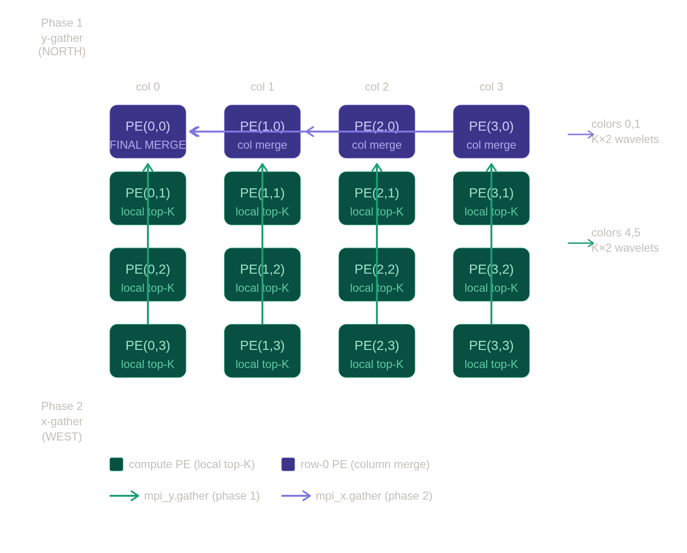

# DESIGN.md
Start time: Friday, May 1 2026, 8:22 AM

## Section 1 - Routing topology

When `run()` is called on every PE, the collectives are initialized, each PE computes its `global_row_start` offset, and `compute_task` is activated. Each PE computes squared L2 distances for its local shard, builds a sorted local top-K list, and calls `mpi_y.gather(root=0)` to send K pairs up the column to row 0. `merge_col_task` fires next, row-0 PEs merge their P x K results into K pairs, then all row-0 PEs call `mpi_x.gather(root=0)` to send K pairs to PE(0,0). `final_task` fires last, PE(0,0) merges P x K results into the global top-K and writes `out_idx` and `out_dist`, and every PE calls `unblock_cmd_stream`.

`q` is memcpy'd to every PE by the host before launch, avoiding a broadcast collective and saving one round-trip.

Colors c2d_y_color_0/1 (IDs 4, 5) carry the y-gather NORTH along columns. Colors c2d_x_color_0/1 (IDs 0, 1) carry the x-gather WEST along row 0. Each wavelet carries one f32 value, alternating between a squared L2 distance and a bitcast global row index.

## Section 2 - Local top-K algorithm

Each PE runs insertion sort over its `rows_per_pe` rows, keeping a sorted list of K `(dist, global_index)` pairs. Global indices are computed as `pe_linear * rows_per_pe + local_row` so the merge can compare entries across PE boundaries. Insertion sort was chosen because K is small (at most 256) and the list stays sorted at all times, making it directly ready for the merge step.

Cost per PE: distance computation costs roughly 2 x d_dim FP ops per row (128 rows x 32 dims x 2 = 8192 FP ops at baseline). Insertion costs K/2 comparisons per row on average (128 x 8 = 1024 at baseline). 

The distance loop dominates at about 8x more work.

## Section 3 - Fabric bandwidth accounting

Each PE sends K x 2 wavelets per gather phase (K pairs, two f32 each). In the worst case (K=256, P=2), 512 wavelets cross a single grid edge per phase, 1024 total across both phases. For the same case each PE does 256 x 32 = 8192 FP ops. The kernel is compute-bound, not bandwidth-bound.

## Section 4 - Tie-breaking argument

Tie-breaking is enforced in two places. In `topk_insert`, a new entry is inserted ahead of an existing one if its distance is smaller, or if distances are equal and its global index is smaller. The same comparison is used in `merge_lists`. This guarantees equal-distance rows are always ordered by ascending global index throughout the pipeline.

Wavelet arrival order does not affect correctness. The `mpi_y.gather` callback only fires after all P PEs in the column have finished sending, so `col_gather` holds complete data before `merge_col_task` runs. The same applies to `final_task` `merge_lists` always operates on complete buffers and produces the same result every run.

## Section 5 - What I'd do with 2x more time

**1. Vectorized distance using `@fmacs`:** The current `squared_l2` uses a scalar while-loop over d_dim elements. The optimized version would subtract q from the row into a scratch buffer using `@fsubs`, then accumulate the squared result with `@fmacs`, replacing the loop with a single pipelined hardware operation on the dominant cost.

**2. Tree reduction:** Instead of gathering all P x K results to one root, do pairwise merges in log2(P) steps where each merge handles only 2 x K pairs. For P=4 this means two parallel merge steps instead of one large one, reducing both root PE work and fabric traffic.
